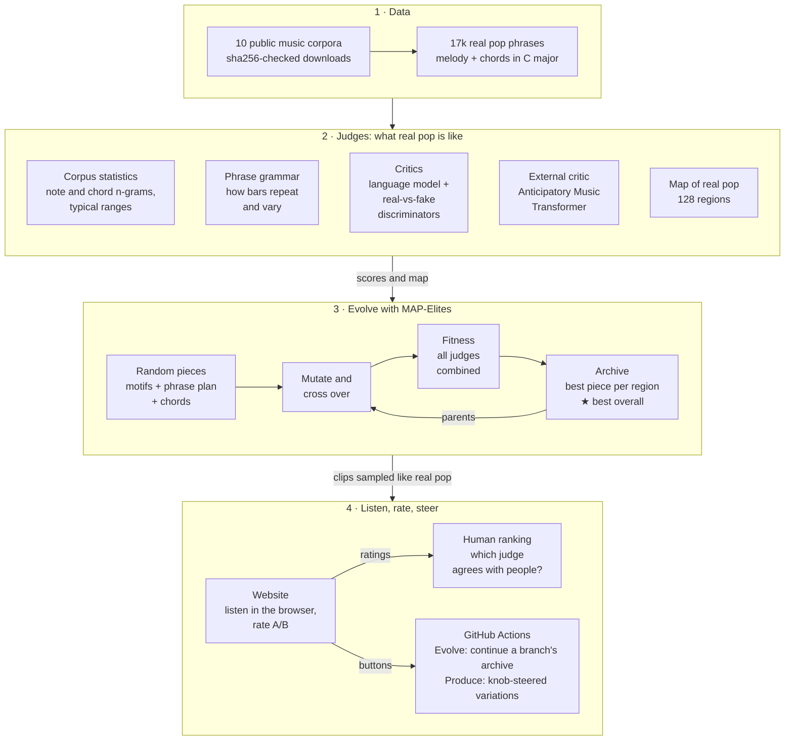
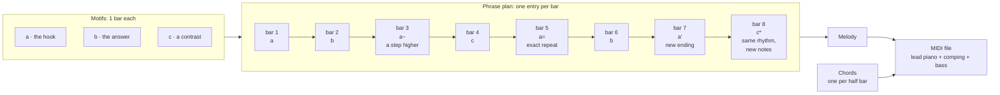

# 🎧 **Listen and rate:  [https://rejunity.github.io/gc-exploring-music](https://rejunity.github.io/gc-exploring-music)**

# gc-exploring-music

Generative music via an evolutionary process. A population of random melodies is
evolved toward "musical" results under a fitness score that combines music-theory
rules, corpus statistics, a learned critic, and occasional human feedback. Output is
standard `.mid` files.

See [PLAN.md](PLAN.md) for the roadmap, datasets, and tooling.

## How it works



1. **Data.** `evomusic.data` downloads ten public music corpora and checks their
   hashes. The main one is Hooktheory: 17k pop phrases with melody and chords,
   transposed to C.
2. **Judges.** From that corpus the system learns what real pop is like: note and
   chord statistics (`fitness/ngram.py`, `fitness/descriptors.py`), a phrase grammar
   of how bars repeat and vary (`form.py`), a transformer language model plus
   real-vs-fake discriminators trained against the evolution itself (`critic/`), and
   a map of 128 regions where real pop lives (`behaviour.py`). The Anticipatory Music
   Transformer, trained by Stanford on Lakh MIDI, is an outside judge (`critic/amt.py`).
3. **Evolution.** MAP-Elites (`mapelites.py`) starts from random pieces, mutates and
   crosses them, scores every piece with all judges combined, and keeps the best
   piece in each region of the map. The star marks the best overall.
4. **Listening.** Clips are sampled in proportion to real pop and published on the
   website, where people listen and rate pairs. Ratings arrive as GitHub issues and
   show which judge agrees with human ears (`ratings.py`, `evaluate.py`). The site's
   Evolve and Produce buttons run more evolution, or knob-steered variations, on
   GitHub Actions.

### How a piece is built



A piece is a few one-bar motifs, a phrase plan saying which motif each bar uses and
how it is transformed, and one chord per half bar (`form.py`). The plans and how often
each occurs come from 17k real pop phrases. Evolution starts from random motifs and
plans and keeps what the judges like.

## Quick start

```bash
uv sync                           # creates .venv with the core deps
uv run python -m evomusic.smoke   # writes out/smoke.mid (a random 8-bar melody)
```

### Generate your first piece (no data needed)

From a fresh clone, the rules-only genetic algorithm runs on the CPU in about
10 seconds and needs no downloads:

```bash
git clone https://github.com/rejunity/gc-exploring-music && cd gc-exploring-music
uv sync
uv run python -m evomusic.evolve --out out/first     # -> out/first/star_*.mid (best) + top1..top4
```

Open the `.mid` in any DAW or player. To get an mp3 instead (needs
`apt install fluidsynth fluid-soundfont-gm ffmpeg`):

```bash
uv run python -m evomusic.render out/first/star_*.mid
```

### Install the corpus (optional, for better-sounding results)

Not needed for the step above. The corpus lets the fitness learn from real pop
melodies. One line downloads every core dataset (~110 MB, sha256-verified),
converts Hooktheory, and fits the corpus statistics:

```bash
uv run python -m evomusic.data download && uv run python -m evomusic.corpus.hooktheory && uv run python -m evomusic.fitness.ngram fit data/processed/hooktheory.jsonl data/processed/ngram_hooktheory.json && uv run python -m evomusic.fitness.descriptors fit data/processed/desc_bands.json
```

Then generate a whole archive of diverse pieces guided by the corpus (CPU, ~1 minute).
The best one is `star_*.mid`; the other files are one per density x melodic-entropy cell:

```bash
uv run python -m evomusic.mapelites --ngram data/processed/ngram_hooktheory.json --desc data/processed/desc_bands.json --iters 300 --out out/corpus
```

The learned-critic mode (transformer critic, adversarial training, GPU) is
described in [PLAN.md](PLAN.md) section 6.7-6.10.

### Evolve and Produce from the website (GitHub Actions)

Two buttons on the site, both running on free GitHub CPU runners and both limited to
the repo owner and collaborators. Each can start from a prefilled issue (one click)
or from the Actions tab's "Run workflow" form.

- **Evolve** runs N iterations of MAP-Elites and commits the result to an experiment
  branch `exp/<name>`, which then appears in the site's branch selector. With
  "continue" on, a run starts from the branch's previous archive, so each branch is a
  lineage. Genome: `form` (motifs + phrase plan, default) or `notes` (flat). Fitness:
  `corpus` (~1 s per iteration) or `critic` (small transformer critic from the
  `critic-v1` release, ~7.5 s per iteration, max 800). Workflow: `.github/workflows/evolve.yml`.
- **Produce** explores what a branch already holds without evolving it: one large
  burst of variations (thousands of candidates), scored against **knobs** and a
  light quality floor, returned as a `.mid` + `.mp3` zip. Nothing is committed.
  Knobs are percentiles of real pop (50 = typical): complexity, predictability,
  density, repetition, darkness, harmonic adventure, energy build. Variation strength
  goes from 1 (subtle) to 5 (wild); "keep" can freeze the hook, the phrase plan or the
  harmony. Workflow: `.github/workflows/produce.yml`. Locally:
  `uv run python -m evomusic.produce --from out/<run>/summary.json --knobs '{"complexity": 80}' --strength 4`.

Both run the large Anticipatory Music Transformer once at the end ("AMT gap":
negative = more natural than typical real pop of that density) and attach a zip of
`.mid` + `.mp3` (GitHub sign-in needed, kept 90 days).

## Data

All corpora are fetched by one script into `data/raw/` (git-ignored). The manifest
`data/manifest.json` pins URLs to commit SHAs / revisions where possible and
records a sha256 of every download plus a hash of the extracted file tree, so a
second machine can check it has byte-identical data.

```bash
uv run python -m evomusic.data list                 # what is in the manifest, what is on disk
uv run python -m evomusic.data download             # all "core" sets (~110 MB download, ~260 MB on disk)
uv run python -m evomusic.data download --tier all  # + Lakh clean_midi (234 MB download, 1.1 GB on disk)
uv run python -m evomusic.data verify               # re-hash disk vs manifest
uv run python -m evomusic.data download --record    # refresh hashes after a deliberate upstream update
```

| name | contents | style | licence |
|---|---|---|---|
| pop909 | 909 songs, melody/bridge/piano MIDI + chord/beat/key txt | pop (Chinese) | MIT |
| hooktheory | Sheet Sage release of TheoryTab: 26,175 segments (23,833 with melody) as JSON with key, meter, melody notes, chords; + 16k MIDI renderings in train/valid/test tarballs | pop (Western) | CC BY-NC-SA 3.0 |
| hlsd_sample | older Hooktheory lead-sheet repo snapshot: crawler + ~40 sample MIDI/JSON (full dump link is dead) | pop (Western) | academic only |
| openewld | 502 lead sheets, MusicXML with chords | pop / standards | public domain |
| wikimusictext | 1,010 lead sheets in ABC with metadata | pop / standards | CC BY-NC 4.0 |
| nottingham | ~1,200 folk tunes, ABC with chords | folk | free |
| essen | 8,473 monophonic tunes, **kern | folk | unclear, see below |
| bach_chorales | 370 four-part chorales, **kern | baroque | CC BY-NC-SA |
| weimar_jazz_db, weimar_jazz_midi | 456 transcribed solos, SQLite + MIDI | jazz | ODbL |
| lakh_clean_midi | 17,256 multi-track MIDI named by artist/title | pop/rock | CC BY 4.0 |

## Listening

```bash
uv run python -m evomusic.render out/smoke.mid   # -> out/smoke.mp3 (fluidsynth + ffmpeg)
```

Needs `apt install fluidsynth fluid-soundfont-gm ffmpeg`.

## Licensing

This repository, https://github.com/rejunity/gc-exploring-music, is licensed under GPL-3.0 (see LICENSE).

### Data licensing notes

- **Essen Folksong Collection**: the legal status is "unclear" (per the music21
  corpus notes; the data was entered by many contributors over decades). It is
  used universally in research. Accepted for this personal research project on
  2026-10-13; **reconsider before any public release of models or derived data.**
- **Hooktheory (Sheet Sage release)**: CC BY-NC-SA 3.0, derived from TheoryTab
  user contributions. Non-commercial, share-alike: anything trained on it or
  derived from it inherits that licence.
- **POP909** and the older **Hooktheory Lead Sheet Dataset** snapshot: research /
  academic use only. Do not commit the raw data to the repo.
- **Nottingham**, **Lakh MIDI (CC-BY 4.0)**, **OpenEWLD (public domain)**: unproblematic.
